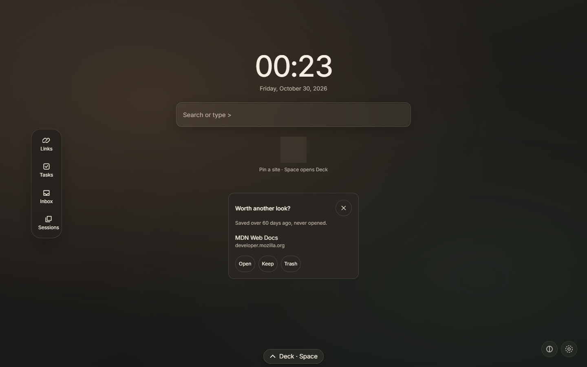
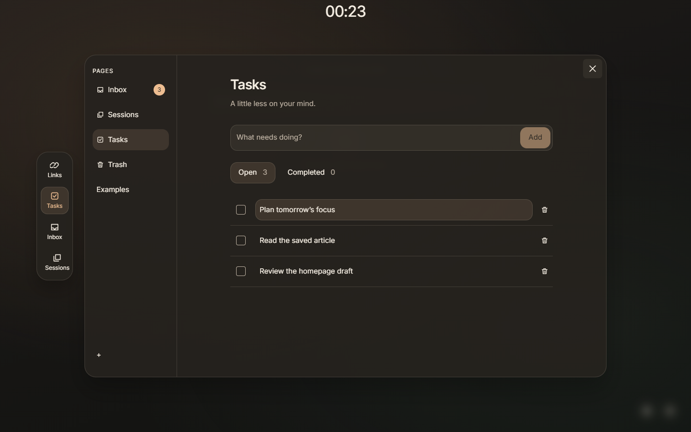

# Deck

A calm Chrome new tab with a glass workspace for links, notes, tasks and saved sessions.

Open a new tab for the clock, The Line and up to twelve pinned links. Choose Links,
Tasks, Inbox or Sessions from the icon rail, or press `Ctrl+J` to open the floating
workspace. The rail moves to the top in narrow windows.

No account, telemetry, remote fonts or automatic runtime network requests.
Data stays on your device. Explicit `?` searches use Chrome's search provider.





These are real captures of the production build in an isolated Chromium profile,
not mockups. The task content is synthetic.

## Current state

The surface, drawer, capture, bookmark import, sessions, open-tab search, daily
resurfacing, tasks and optional Shelf are implemented. Glass navigation and the
dedicated Tasks view are the latest first edit.

This is an unreleased working build. Owner visual review, physical Chrome shortcuts,
permission prompts, real-display checks and the field trial remain open. Strict
startup acceptance is unfinished: the sub-60 ms warm target is a goal, not a guarantee
for every load. Sync and ongoing bookmark mirroring are not implemented.

Product owner: Kasra. This repository documents the working build, without a
Chrome Web Store release or public rating claim.

## Features

- **The Line:** search links and notes, run `>` commands, or search the web with `?`.
  Open-tab search asks for optional access.
- **Links and Inbox:** organize pages, decks and cards with mouse or keyboard.
  Move, pin, rename and trash items; edit notes with Markdown preview.
- **Tasks:** add with Enter, view open/completed tasks, complete or reopen them,
  edit notes, and recover deletions through Trash or Undo.
- **Capture and sessions:** Quick Save sends a page to Inbox without a destination
  picker. Stash saves eligible tabs; saved decks can reopen as tabs or tab groups.
- **Appearance:** Night, Day and System themes, local wallpapers, privacy blur,
  reduced-motion support and Custom CSS with stable `data-deck` hooks.
- **Optional Shelf and daily resurfacing:** show selected decks on the surface
  or revisit an older saved link.
- **Local recovery:** JSON export/import, seven daily snapshots, migration
  safeguards and snapshot fallback when the live database cannot be read.
  Export a backup before testing destructive changes.

### Why recovery uses two local stores

The [backup service](apps/extension/src/storage/backup.ts) keeps up to seven
snapshots in IndexedDB and copies the latest snapshot to `chrome.storage.local`.
Export tries the live document first, then the newest valid snapshot if reading
the live document fails. The separate copy can still be read when the database
cannot be opened; invalid snapshots are rejected rather than exported as valid
data. This improves recovery from a database failure, but both stores belong to
the same browser profile: they are not an off-device backup. Export JSON to a
separate location before removing the extension or clearing browser data.

## Keyboard entry points

| Action                             | Default            |
| ---------------------------------- | ------------------ |
| Open or close the workspace        | `Ctrl+J`           |
| Open from an empty Line            | `Space`            |
| Quick Save the current page        | `Ctrl+Shift+S`     |
| Stash eligible tabs                | `Ctrl+Shift+D`     |
| Save Line text as a task in Inbox  | `Ctrl+Shift+Enter` |
| Keyboard help outside a text field | `?`                |

Space opening can be disabled in Settings. Rebind Chrome-level shortcuts at
`chrome://extensions/shortcuts`; Chrome may reserve or override a physical shortcut.

## Permissions and privacy

Install-time permissions are exactly `storage`, `unlimitedStorage`, `favicon` and
`contextMenus`. The `commands` manifest entry is not a permission.

| Optional access           | Purpose                                                  |
| ------------------------- | -------------------------------------------------------- |
| `activeTab` + `scripting` | Quick Save and its toast on the page where you invoke it |
| `tabs`                    | Stashing and searching/managing open tabs                |
| `tabGroups`               | Opening a saved deck as a Chrome tab group               |
| `bookmarks`               | One-shot import from Chrome bookmarks                    |
| `search`                  | Explicit `?` web searches                                |

Optional access is revocable from Settings. Deck has no persistent content script,
account, backend or analytics. Fonts are bundled; favicons use Chrome's local API.

## Development

Requirements: Node.js 22+ and pnpm 9.15.9. No backend or account is required.

```bash
git clone https://github.com/boyInShadows/DeckExtention.git
cd DeckExtention
corepack enable
pnpm install --frozen-lockfile
pnpm build
```

1. Open `chrome://extensions` and enable **Developer mode**.
2. Choose **Load unpacked** and select this clone's `apps/extension/dist` folder.
3. Open a new tab. Deck should show its clock, Line and workspace navigation.
4. Open Settings and export a JSON backup before importing or deleting data.

For development, run `pnpm dev`; after a production rebuild, reload Deck on the
extensions page and open a new tab. To run browser tests, first install their
browser with `pnpm exec playwright install chromium`.

| Command              | Purpose                                               |
| -------------------- | ----------------------------------------------------- |
| `pnpm dev`           | Vite/CRXJS development build                          |
| `pnpm lint`          | TypeScript, ESLint, CSS and formatting checks         |
| `pnpm test`          | Unit and integration tests                            |
| `pnpm build`         | Production extension in `apps/extension/dist`         |
| `pnpm size`          | Build and enforce gzip bundle budgets                 |
| `pnpm e2e`           | Build and run Chromium extension journeys             |
| `pnpm test:coverage` | Merge unit/browser coverage and enforce the 80% floor |

Budgets remain **60 kB gzipped for the surface**, **180 kB for the drawer**, and an
additional **21 kB surface-entry gate**. Coverage runs restore the normal production
build when they finish, including after failures.

### Repository layout

```text
apps/extension/       Manifest, Vite configuration and extension source
  src/               Features: newtab, drawer, tasks, capture, sessions, storage...
  public/            Bundled extension icons
  dist/              Generated unpacked extension (ignored)
packages/schema/     Shared Zod schemas, types, constants and fixtures
tests/e2e/           Chromium extension journeys
tools/               Repository-owned lint rules, icon generation and coverage
docs/                Local planning, reports, previews, archives and artifacts
.github/workflows/   Quality checks
```

Source and component tests stay together by feature; browser journeys stay in
`tests/e2e`. Font licensing and provenance stay beside the bundled font.

Test output goes to `docs/artifacts/test-results`; coverage goes to
`docs/artifacts/coverage/{unit,e2e,merged}`. Historical experiments and reports are
retained in `docs/archive`; current UI previews are in `docs/ui-concepts`.
Local planning documents and raw reports are deliberately not published. Only the
two selected showcase captures above are included in this README.

### Stack and developer helpers

pnpm workspaces, strict TypeScript, Vite + CRXJS, React 19 interfaces using
`preact/compat` at runtime, Tailwind 4, IndexedDB via `idb`, `dnd-kit`,
`fractional-indexing`, Zod, Vitest, Playwright and `size-limit`.

Repository tooling lives in `tools/` and is versioned. CodeBaseMemory, Graphify and Ponytail
are external development aids, not extension dependencies; the machine's external
tools directory is not needed to run Deck.

### Verification and limits

The 2026-10-30 presentation review used the published `main` source at `ad2ff11`:
frozen installation, lint, 726 unit/integration tests, production build and all
three bundle budgets passed. An unpacked production build also passed the backup
export/import, keyboard and responsive task journeys in Chromium 151.

One large tab-group browser test failed while waiting for Playwright's page count
to match Chrome's tab count. Playwright 1.63 expects Chromium 153; downloading it
locally was blocked with a regional HTTP 403. These checks do not establish full
browser-suite, physical-shortcut, performance or field-trial acceptance. The
[quality workflow](.github/workflows/quality.yml) retains its existing checks;
consult the actual run result rather than treating the file as a passing badge.

## License

Not yet chosen.
